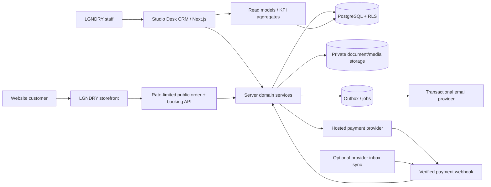

# 02 — Technical Requirements Document (TRD)

**System:** LGNDRY.Co Studio Desk  
**Architecture:** modular web application with server-enforced domain workflows and provider adapters  
**Status:** recommended implementation architecture, subject to environment/provider confirmation.

## 1. Architecture decisions

| Layer | Proposed choice | Rationale |
|---|---|---|
| Web UI | Next.js App Router, React, TypeScript | SSR/route handlers, data-driven views, typed components |
| Styling | Tailwind CSS + LGNDRY-owned CSS variables; optional accessible headless UI primitives | Directly recreate original prototype and screenshot without generic library aesthetics |
| Icons | Lucide-style 1.5px stroke icon set or extracted icons from original prototype | Visually consistent, simple line symbols |
| Database | Supabase PostgreSQL with SQL migrations | Constraints, transactions, relational history, strong access control |
| Authentication | Supabase Auth using secure, server-validated sessions and optional MFA | Internal users with identity and session controls |
| Object storage | Private Supabase Storage buckets, signed URLs | Invoices, proofs, agreements, artwork assets |
| Business logic | `packages/domain` + server-only services | Shared state machines and financial logic; UI cannot manipulate authority |
| Integrations | Typed provider adapters (email, hosted payments, inbound email, QR, storefront) | Providers can be changed without rewriting app |
| Async | Transactional outbox + hosted queue/worker or scheduled job runner | Reliable emails, retries, expiry and webhook processing |
| Validation | Zod (or equivalent) at all network boundaries | Reject malformed/overlong requests with structured errors |
| Tests | Vitest/unit, integration DB tests, Playwright e2e and screenshot visual tests | Functional, security and appearance coverage |
| Tooling | pnpm workspace, ESLint, TypeScript strict, CI | Reproducible builds and dependency boundaries |

**Versioning:** Install currently supported stable versions, pin them in lockfiles and validate compatibility in CI. Do not guess framework version numbers or rely on unmaintained demo packages.

## 2. Logical system context

The **CRM server/database is authoritative** for customers, orders, invoice statuses, edition allocations and bookings. The storefront calls public APIs; it must not independently decrement stock, mark invoices paid or assign unique edition numbers.

## 3. Deployment and environments

| Environment | Identity | Data | External effects |
|---|---|---|---|
| Local dev | local auth/test identities | seeded synthetic records only | mocks/sandbox providers |
| Staging/UAT | separate Supabase project, staging roles | synthetic or approved anonymised | sandbox email/payments, webhook test |
| Production | restricted production auth + MFA | genuine data | configured live services with approvals |

- Environment values via secret management; `.env.example` only placeholders, never live credentials.
- Public pages and internal app must have separate origin/route permissions; use HTTPS and appropriate headers.
- Treat inbound emails, uploads, webhooks and public API requests as untrusted.
- Explicit `DEMO_MODE` only for demo deployments. Demo actions must not mutate production systems or call live providers.
- Hosted storage regions, transfers and third-party operators must be assessed against South African privacy obligations before launch.

## 4. UI engineering requirements

- Extract and map original HTML elements: `.sidebar`, `.brand`, `.nav-btn`, `.topbar`, `.page-title`, `.kpi-grid`, `.panel`, charts, forms, drawers, search overlays and local-state seed. Preserve equivalent behaviours as typed components.
- Prefer server-rendered initial datasets and client components for filters, drawers, schedules, menu and forms. Avoid loading customer financial data into global client state unnecessarily.
- Desktop floating sidebar inset about 10–14px, width about 190–230px depending on viewport, full-height minus inset; internal scrolling if items exceed available height. Mobile becomes a modal drawer with backdrop, focus trap, keyboard Escape and scroll lock.
- Layout reference image is 1672×941. Also test at 1440×900, 1280×800, 768×1024 and 390×844. No horizontal overflow in intended views.
- Brand tokens from `05_BRAND_AND_DESIGN_SYSTEM.md`; use real artwork only when rights/asset files are available. Otherwise placeholders must be visibly provisional and not misrepresented as commercial inventory.
- Chart source: server aggregations of eligible transactions; chart and table views must agree.
- Search should query server-permitted records (customers, orders, artworks, bookings, invoices and threads) with debouncing, pagination and RBAC-filtered results.

## 5. Data design rules

- UUID primary keys internally; separately generated user-facing serials/references for orders and invoices. Invoice serial generation must be transactional, monotonic within configured prefix/financial year, and non-colliding.
- Store money in **integer smallest currency units** (ZAR cents), currency codes in ISO 4217, and tax calculation snapshots; never use JavaScript floating-point arithmetic as the canonical ledger.
- Use UTC timestamps in DB; convert to `Africa/Johannesburg` for calendar/date UX. Booking scheduling must store UTC start/end and local timezone used to interpret booking requests.
- Enforce referential integrity in DB; do not rely on frontend checks for stock/reservations/resource collisions.
- Append immutable financial and security history. Use status transitions + ledger entries instead of destroying historical invoice/payment records.
- Protect file assets with private buckets and short-lived scoped signed URLs.
- All tables with personal/transaction data require role-aware RLS and appropriate grants; service role never in browser.
- Schema source of truth is `06_DATA_MODEL.md`; migration files become the executable source of truth after implementation.

## 6. Transaction and concurrency requirements

**Order placement (one DB transaction):** validate server prices/stock; upsert customer; create order+lines; reserve available capacity; issue invoice draft/approved invoice document metadata; write outbox jobs; commit. Do not send email inside the DB transaction. A retry with the same idempotency key returns the same order.

**Verified payment (one DB transaction):** verify provider signature and event id; check amount, currency, merchant invoice, payer context and status; insert unique provider event; append payment ledger entry; mark invoice paid as appropriate; allocate edition number/activate booking confirmation when conditions are met; enqueue notifications. Repeated webhook events must be safe no-ops.

**Edition allocation:** database locking/unique constraint on `(edition_run_id, number)` and eligible payment; enforce count <= edition cap even under concurrent orders. Unpaid reservations consume availability only until expiry and do not permanently assign numbers.

**Booking confirmation:** atomic check for confirmed overlapping resource assignments. Tentative requests may overlap; confirmed bookings for the same required resource must not.

## 7. External interfaces

- **Public storefront:** `POST /api/public/orders`, `POST /api/public/booking-requests`, optional GET availability/canonical artwork listing; strict rate limits, bot control, input validation and server-side pricing.
- **Studio staff:** authenticated route handlers/server actions with permissions, support list/filter/search/pagination and optimistic concurrency where useful.
- **Payment provider:** create hosted payment session, retrieve verified status, validate signature/event and issue refunds through authorized flows. Prefer provider-hosted PCI-sensitive checkout to avoid storing card numbers.
- **Emails:** transactional acknowledgement, invoice issue/paid, overdue reminder, booking request/quote/deposit/confirmation, fulfilment updates. Provider delivery state and retry semantics.
- **Inbox:** later Gmail or Microsoft 365 API connector; use OAuth and delegated scoped permissions, never scrape mailbox passwords.
- **Invoices/PDF:** render document server-side using a reviewed template; no public unauthenticated raw PDF URL. QR resolves to hosted session through secure opaque token.

For detailed request/response examples and security restrictions see `07_API_AND_INTEGRATIONS.md`.

## 8. Observability and operations

- Correlation IDs across public order request -> order -> invoice -> email -> payment webhook -> fulfilment.
- Structured logs for status transitions and failures; redact names, email bodies, addresses, tokens, payment payloads and signed URLs.
- Operational views for invoice email failures, unmatched payments, failed webhook verifications, reservation-expiry jobs, booking conflicts and stuck production states.
- Outbox job retry with backoff, dead-letter/error queue and approved manual replay; jobs idempotent.
- Daily backups with routine restore testing; documented RPO target <=24h and RTO target <=8h until service level has been validated.
- Alerts for failed payments webhook processing, mass failed email sends, privileged access anomalies and data integrity errors.

## 9. Quality and performance targets

| Attribute | Target / acceptance basis |
|---|---|
| Interaction | Common CRM navigation and record detail usable promptly on typical office devices; measure with actual dataset |
| Dashboard | Query/aggregate under 2 seconds p95 for baseline production dataset, subject to measured tuning |
| Search | Debounced; return first permission-filtered results under 1 second p95 on typical connection |
| Reliability | no duplicate payments, edition numbers, invoice serials or confirmed crew conflicts |
| Accessibility | keyboard use; semantic labels; focus restoration; WCAG 2.2 AA review |
| Responsive | 390px phone to 1672px desktop; sidebar drawer on smaller viewports |
| Security | critical and high issues fixed before go-live; RLS and role tests in CI |
| Financial | displayed totals reconcile with invoice/payment ledger to cent |

These are implementation **targets**, not proven current service-level guarantees.

## 10. Engineering constraints and anti-patterns

Do not: retain localStorage as production database; expose service-role keys; implement payment confirmation through a frontend callback alone; allow clients to post their own invoice total; conflate quote/booking request with invoice/confirmed booking; allocate numbered editions before verified payment; use mock analytics as live; bury server authorization inside UI visibility checks; or publish a functional-looking Send/Refund button without integration/permissions.

## 11. Important external technical references

- Next.js auth and server-side authorization: https://nextjs.org/docs/app/guides/authentication
- Next.js data security and route protection: https://nextjs.org/docs/app/guides/data-security
- Supabase RLS and privilege grants: https://supabase.com/docs/guides/database/postgres/row-level-security
- Supabase Next.js / SSR auth: https://supabase.com/docs/guides/auth/server-side

Recheck official docs before installing; package APIs may evolve. This document is not a substitute for an infrastructure security review.
