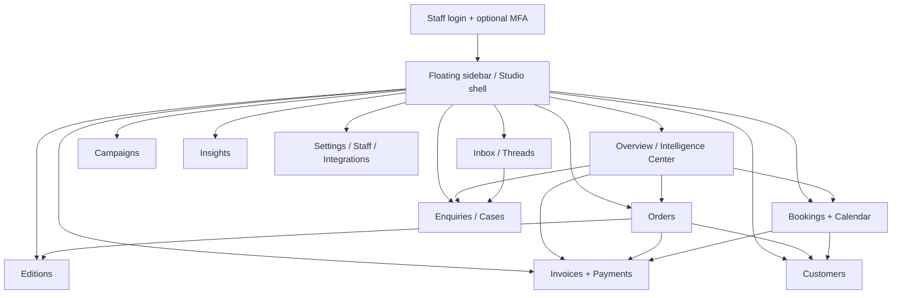
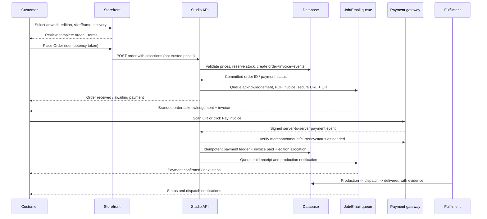
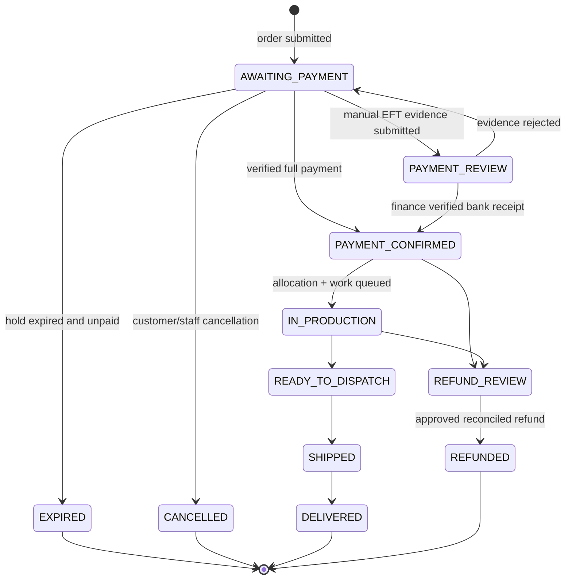
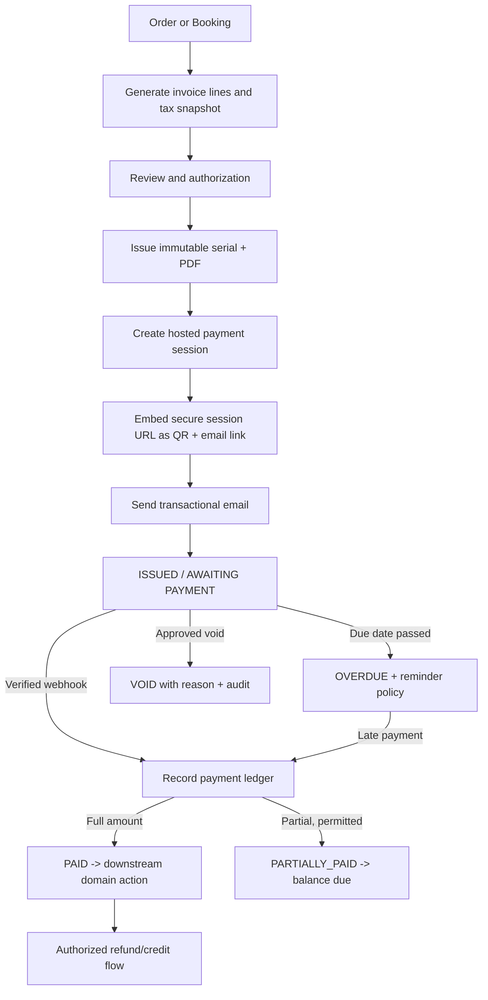
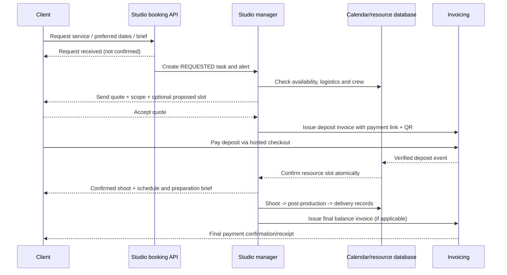
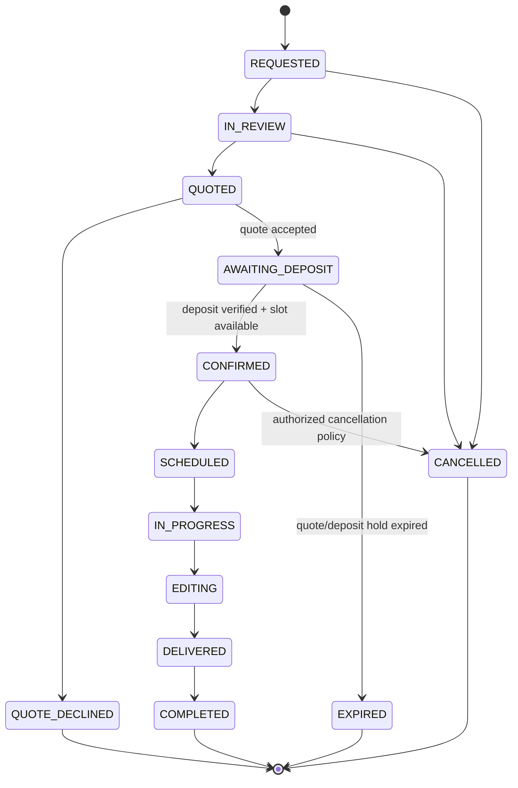
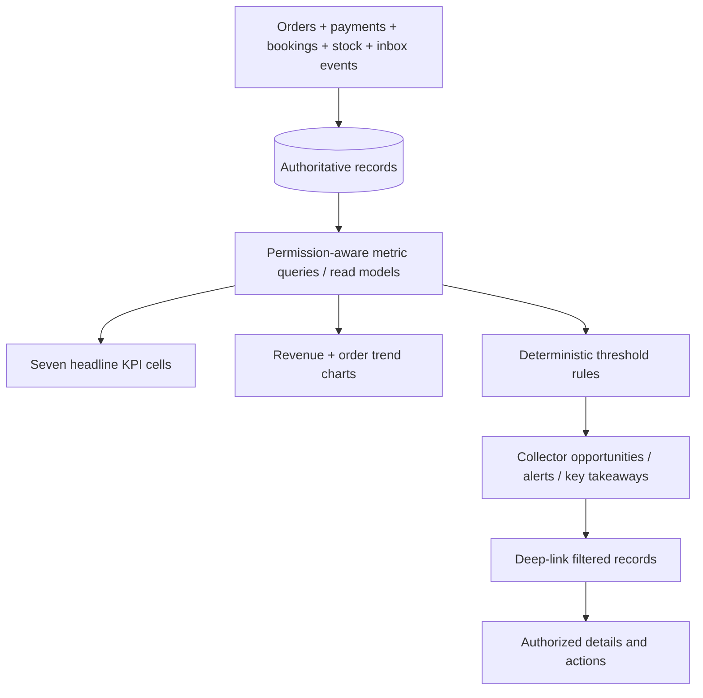

# 03 — Application Workflow and State Specification

**Purpose:** define what users see, which entity changes, which event is emitted, what fails safely, and which views update. The screenshot specifies the intended UI; these flows specify functional behaviour.

## 1. Navigation and screen structure

**Global command search:** Ctrl/Cmd+K opens a query dialog -> authorized results across customers/orders/artworks/bookings/invoices/enquiries/threads -> select -> record detail drawer or full-page view -> preserve back navigation. No unauthorized results should be surfaced.

**Mobile navigation:** menu -> focus trapped overlay -> choose page -> close and restore focus; Escape/backdrop closes. All tables provide responsive summary rows and details.

## 2. Art order: website to production

**Order rules:**

1. Accept guest ordering; use verified contact email as identifier, not a mandatory storefront password.
2. Customer reviews entire transaction, corrections and terms before submission.
3. Create order with `AWAITING_PAYMENT`. Do not use wording implying paid/confirmed production.
4. Temporary stock hold is configurable (proposed default 72h; requires business approval). On expiry, release hold and offer a new order/payment session if still available.
5. The PDF and QR must reference the same approved invoice/payment session; the QR is not a raw static bank-detail payload.
6. The payment provider acknowledgement in the browser is **not** a trusted payment event. Only validated webhook or finance-controlled reconciliation can mark paid.
7. Payment and edition allocation share a transaction and unique constraints; duplicate events change nothing.
8. If gateway payment arrives after reservation expiry/sell-out, flag `PAYMENT_EXCEPTION`, safeguard money, stop allocation, and request finance resolution/refund; do not fabricate availability.
9. A failed notification does not roll back a valid order/payment; it enters outbox retry with visible operational alert.
10. Partial payment (if allowed by Finance) leaves invoice partly paid and order unapproved for production unless a policy specifically permits a deposit.

### Order state machine

**Note:** Statuses above are logical state labels; a payment, invoice, order and fulfilment have distinct state columns and historical transitions. An order can be `DELIVERED` while invoice has a separate (e.g. corrected) financial record.

## 3. Invoice/payment workflow

**Invoice PDF content:** correct legal issuer, recipient, invoice/reference number, issue/due dates, description, quantity, price, net/tax/total (depending on tax configuration), amount paid/balance, secure QR, Pay Invoice link, terms and contact. Do not label a document `Tax Invoice` unless authorized by the VAT/business configuration. Document issue and later amendments use immutable snapshots and a credit/void approach.

**Invoice UX:** searchable table with number, customer, source (order/booking), total, balance, status, due date and actions; detail drawer shows PDF preview, payment history, QR, send status, internal notes and audit timeline. `Resend`, `Void`, `Refund`, `Mark Paid` buttons are role-/integration-gated.

## 4. Photography booking workflow

### Booking state machine

**Important conflict case:** if the desired time becomes unavailable before deposit verification, record a scheduling exception and initiate a new slot offer. Taking a deposit without a viable slot must not result in a silent confirmation.

**Booking calendar:** staff can view month/week/day; statuses have visible text and distinct treatment, not color only. Assign crew and equipment only to supported availability models. Lock confirmed resource time ranges transactionally. Show time zone next to schedule. Calendar cards link to booking record with customer, shoot brief, quotation, deposit and communications.

## 5. Enquiries and Inbox — separate responsibilities

```mermaid
flowchart LR
  Source[Website form / Email / Staff entry] --> Match[Find or create customer]
  Match --> Thread[Inbox thread + messages]
  Thread --> Case[Linked enquiry / case when action needed]
  Case --> Assign[Assignee, priority, due/SLA]
  Assign --> Work[Reply, book, quote, issue invoice, follow-up]
  Work --> Resolve[Resolved / converted / closed]
  Resolve --> Timeline[Customer activity timeline]
```

- **Inbox** holds individual messages, participants, delivery state, attachments and thread membership. A thread can link to an enquiry, order, booking or invoice.
- **Enquiries** hold operational intent, ownership, priority and resolution. Many messages can belong to one enquiry, and a booking request can itself be converted into a booking.
- Emails from verified inbound provider appear with source/received metadata; without provider, show transactional outbound history only and display `Inbound sync not connected`.
- Draft -> queued -> provider accepted/sent -> delivered/bounced where provider supports it. Do not mark a message sent on local save.
- Sensitive attachments require scan, size/type limits, private storage and auditable access.

## 6. Intelligence Center data lifecycle

- Every numerical insight cites its calculation window, denominator and last-refresh time.
- Prefer deterministic rules (e.g. >3 product views in 7 days **with tracking consent**) until event instrumentation supports reliable models.
- Paid revenue is never computed from invoice issue alone.
- Historic screenshots/seed data never substitute for real read model results.

## 7. Exception matrix

| Event | System action | User-facing response |
|---|---|---|
| Duplicate order POST | Return existing order by idempotency key | One order reference only |
| Edition inventory exhausted | Reject order/hold; don't allocate | Sold out / offer contact or alternate work |
| Failed invoice email | Retry outbox; flag to staff | Order still received; do not claim email sent |
| Payment webhook duplicated | Ignore duplicate after recording first | No duplicate receipt/edition number |
| Payment amount mismatch | Quarantine/unmatched payment | Finance review needed, order not paid |
| Payment after stock hold expires | Reconcile money; hold allocation; raise exception | Studio contacts customer about options |
| Booking collision | Block confirmation and offer alternate date | Request remains tentative |
| Inbound email disconnected | No simulated inbound history | Inbox shows `Not connected` |
| Marketing consent missing | Suppress contact from campaign | Staff can still send permissible transactional updates |
| Permission denied | 403 + safe audit signal | No private data or button side effects |
| PDF generation unavailable | Retry job and surface document exception | No false invoice attachment claim |

## 8. User feedback / notifications

Use short, factual messages: “Order received — awaiting payment”, “Invoice issued”, “Payment verified”, “Booking request received”, “Booking confirmed for [date]”, “Message queued”, “Email failed — retry available”, “Edition allocation blocked — stock exception”. Do not label drafts `Sent`, unpaid invoices `Paid`, or tentative requests `Confirmed`.

## 9. Email timeline templates (content and triggers)

| Trigger | Email subject concept | Attachment / action |
|---|---|---|
| Order accepted for processing | `LGNDRY | We've received order [reference]` | Invoice PDF, pay link + QR, next steps |
| Payment verified | `LGNDRY | Payment confirmed for [reference]` | Receipt, preparation timeline |
| Order dispatched | `LGNDRY | Your artwork is on its way` | Tracking and support contact |
| Booking request received | `LGNDRY | Your photography request` | Request summary, review expectations |
| Quote issued | `LGNDRY | Your photography quotation` | Quote PDF/link, expiry, acceptance action |
| Deposit invoice issued | `LGNDRY | Deposit invoice for [booking reference]` | Pay link + QR, booking condition |
| Shoot confirmed | `LGNDRY | Your session is confirmed` | Calendar details / preparation instructions |
| Invoice overdue | `LGNDRY | Invoice [reference] payment reminder` | Updated payable balance, payment link |

All sends must use approved templates, opt-in/out rules as applicable and provider status tracking.
