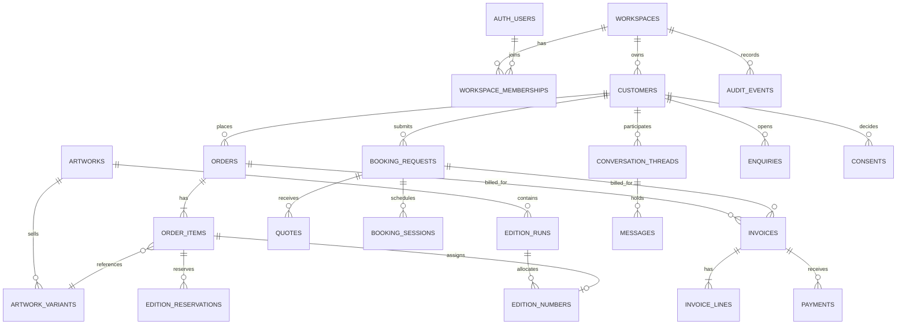

# 06 — Backend Data Model and Schema Specification

**Database:** PostgreSQL (Supabase-hosted recommended).  
**Purpose:** authoritative, relational source for customers, prints, orders, bookings, invoices, payment ledger, communications and intelligence.  
**Implementation note:** types below describe logical fields. Create tested SQL migrations; do not assume this Markdown is executable migration code.

## 1. General conventions

- Primary keys: `uuid` (server-generated). Foreign keys: same type; `workspace_id` on tenant-owned records; LGNDRY v1 has one workspace.
- Timestamps: `timestamptz` UTC (`created_at`, `updated_at` and event-specific timestamps); display in Africa/Johannesburg.
- Financial amounts: `bigint` integer cents (`amount_cents`, `tax_cents`, `total_cents`, etc), `currency='ZAR'`. No floating-point ledger.
- Statuses: explicit type-safe enums/check constraints, domain-controlled transitions and append-only transition events.
- Soft-delete/anonymization for customer PII as approved; never hard-delete issued invoice, settled payment or audit event.
- Sensitive free text limited and access-controlled; avoid storing bank card data or full payment provider payloads.
- Index workspace, foreign keys, status+date and user-facing references. Audit actor and correlation ID on state changes.
- Record time and source for event-derived metrics; no analytics mixing with demo fixtures.

## 2. Core relational diagram



## 3. Identity and administration tables

| Table | Key fields | Rules |
|---|---|---|
| `workspaces` | `id`, `slug`, `name`, `legal_name`, `currency`, `timezone`, `tax_config_json`, `created_at` | one LGNDRY workspace at v1; configuration access restricted |
| `staff_profiles` | `user_id` FK auth, `display_name`, `avatar_asset_id`, `active`, `last_seen_at` | only invited staff have profiles |
| `workspace_memberships` | `id`, `workspace_id`, `user_id`, `role`, `active`, `invited_by`, `joined_at` | UNIQUE(workspace_id,user_id,role); disable effective access on deactivation |
| `role_permissions` | `role`, `resource`, `action`, `allowed` | seed from reviewed matrix; changes audited/approved |
| `integrations` | `id`, `workspace_id`, `kind`, `provider`, `status`, `config_version`, `last_verified_at`, `secret_ref` | config only; secrets external secret manager |
| `audit_events` | `id`, `workspace_id`, `actor_user_id` nullable, `service_actor`, `entity_type`, `entity_id`, `action`, `before_redacted`, `after_redacted`, `reason`, `request_id`, `created_at` | append-only; no sensitive payload dumps |
| `system_jobs` | `id`, `workspace_id`, `kind`, `payload_ref`, `idempotency_key`, `state`, `attempt_count`, `next_attempt_at`, `last_error_code` | reliable outbox, retry controls |

**Access:** staff permissions determined from active membership and server-checked role; no self-grant privileges.

## 4. Customer and consent tables

| Table | Key fields | Rules |
|---|---|---|
| `customers` | `id`, `workspace_id`, `customer_type`, `display_name`, `first_name`, `last_name`, `company`, `primary_email_normalized`, `phone_e164`, `segment`, `owner_user_id`, `source`, `notes`, `created_at`, `archived_at` | unique normalised email per workspace where available; merge audits |
| `customer_addresses` | `id`, `customer_id`, `kind` billing/delivery, `line1`, `line2`, `city`, `region`, `postal_code`, `country`, `is_default` | restricted contact data, snapshot to orders/invoices |
| `customer_merges` | `id`, `workspace_id`, `kept_customer_id`, `merged_customer_id`, `actor_id`, `reason`, `created_at` | preserves linked activity, one auditable canonical profile |
| `consents` | `id`, `customer_id`, `purpose`, `channel`, `granted`, `proof_source`, `policy_version`, `recorded_at`, `revoked_at` | separate transactional legal basis from marketing permission; latest state wins |
| `customer_events` | `id`, `customer_id`, `event_type`, `entity_type`, `entity_id`, `occurred_at`, `metadata_safe_json` | visible timeline and deduplicated analytics source |

**Privacy:** customer records containing contact data must not be read by Analysts/Photographers unless explicitly scoped. Avoid tracking identifiable browsing events without reviewed notice/consent and a lawful basis.

## 5. Artworks, variants, edition stock

| Table | Key fields | Rules |
|---|---|---|
| `artworks` | `id`, `workspace_id`, `sku`, `title`, `collection`, `description`, `release_status`, `cover_asset_id`, `published_at` | UNIQUE(workspace_id,sku), published controlled |
| `artwork_variants` | `id`, `artwork_id`, `edition_run_id`, `size_label`, `width_mm`, `height_mm`, `frame_option`, `price_cents`, `currency`, `active`, `production_cost_cents` optional | price authority server-side; each variant maps to correct run |
| `edition_runs` | `id`, `artwork_id`, `run_code`, `title`, `max_copies`, `low_stock_threshold`, `release_at`, `retired_at` | UNIQUE(artwork_id,run_code), max_copies positive, changes controlled |
| `edition_reservations` | `id`, `edition_run_id`, `order_item_id`, `quantity`, `state`, `expires_at`, `released_at`, `created_at` | active holds count against capacity; expiry job and transaction locks |
| `edition_numbers` | `id`, `edition_run_id`, `number`, `order_item_id`, `allocated_at`, `coa_asset_id`, `released_by_refund_at` nullable | UNIQUE(edition_run_id,number); UNIQUE(order_item_id) for single-unit lines (or line allocation join table for quantity >1); allocation only after verified paid event |
| `assets` | `id`, `workspace_id`, `bucket`, `object_key`, `mime_type`, `size_bytes`, `checksum`, `visibility`, `uploaded_by`, `created_at` | private by default; derivative/public image storage separately approved |

**Model decision:** print size/frame may or may not alter edition numbering. `edition_run_id` is explicit to avoid conflating variants with edition scarcity. **Business must approve whether size-specific variants share a numbered edition run.** Until decided, treat a run as shared across variants unless explicitly configured otherwise. Oversell guard always counts all variants referencing the run.

## 6. Orders and fulfilment

| Table | Key fields | Rules |
|---|---|---|
| `orders` | `id`, `workspace_id`, `order_ref`, `customer_id`, `origin`, `status`, `currency`, `subtotal_cents`, `delivery_cents`, `tax_cents`, `discount_cents`, `total_cents`, `billing_snapshot_json`, `delivery_snapshot_json`, `placed_at`, `paid_at`, `cancelled_at`, `version` | UNIQUE(workspace_id,order_ref), server-computed snapshots, optimistic version |
| `order_items` | `id`, `order_id`, `artwork_variant_id`, `edition_run_id`, `quantity`, `unit_price_cents`, `tax_cents`, `line_total_cents`, `title_snapshot`, `variant_snapshot_json` | immutable price snapshot after submission; quantity >1 requires multiple unique edition numbers |
| `fulfilment_events` | `id`, `order_id`, `order_item_id` nullable, `state`, `carrier`, `tracking_ref`, `evidence_asset_id`, `actor_id`, `occurred_at` | append-only operational history |
| `order_state_events` | `id`, `order_id`, `from_state`, `to_state`, `actor_id`, `source`, `reason`, `created_at` | authoritative transition audit |
| `idempotency_keys` | `id`, `workspace_id`, `scope`, `key_hash`, `request_hash`, `result_entity_id`, `expires_at` | UNIQUE(workspace_id,scope,key_hash); same key + different payload rejected |

**Capacity constraint:** active reservations + allocated numbers must not exceed `edition_runs.max_copies`. Enforce under row lock / serializable transaction; UI stock counts alone are insufficient.

## 7. Booking, shoot and quotation tables

| Table | Key fields | Rules |
|---|---|---|
| `booking_requests` | `id`, `workspace_id`, `booking_ref`, `customer_id`, `service_type_id`, `brief`, `location_text`, `preferred_start_at`, `preferred_end_at`, `status`, `assignee_id`, `quoted_at`, `confirmed_at`, `cancelled_at` | UNIQUE(workspace_id,booking_ref); no immediate calendar confirmation |
| `booking_services` | `id`, `workspace_id`, `name`, `description`, `base_price_cents` nullable, `deposit_policy_json`, `active` | business-configured service types |
| `quotes` | `id`, `booking_request_id`, `quote_ref`, `currency`, `line_items_snapshot_json`, `subtotal_cents`, `tax_cents`, `total_cents`, `deposit_cents`, `expires_at`, `status`, `accepted_at`, `document_asset_id` | immutable issued quote snapshot, approval event |
| `booking_sessions` | `id`, `booking_request_id`, `start_at`, `end_at`, `timezone`, `location`, `session_status`, `confirmed_at`, `production_status`, `delivery_at` | only confirmed sessions block resource, and only if deposit/approval conditions met |
| `resources` | `id`, `workspace_id`, `kind` crew/equipment/studio, `label`, `active` | assignment rules |
| `booking_assignments` | `id`, `booking_session_id`, `resource_id`, `role`, `start_at`, `end_at` | prevent overlaps among confirmed sessions for the same resource (exclusion constraint or transactional check) |
| `booking_deliverables` | `id`, `booking_request_id`, `kind`, `status`, `asset_id`, `due_at`, `delivered_at` | private briefs/assets, permission-controlled |

**Conflict note:** requests and temporary holds can overlap; paid confirmed assignments cannot overlap for the same resource/time (unless explicitly allow-listed).

## 8. Invoices, payments and financial events

| Table | Key fields | Rules |
|---|---|---|
| `invoice_sequences` | `workspace_id`, `series`, `next_number` | row-locked transactional sequence |
| `invoices` | `id`, `workspace_id`, `invoice_ref`, `customer_id`, `source_type`, `source_id`, `kind` deposit/final/print, `status`, `currency`, `subtotal_cents`, `tax_cents`, `total_cents`, `paid_cents`, `balance_cents`, `issued_at`, `due_at`, `voided_at`, `version`, `document_asset_id` | UNIQUE(workspace_id,invoice_ref), check balance = total - settled/refunded ledger appropriately |
| `invoice_lines` | `id`, `invoice_id`, `description`, `quantity`, `unit_amount_cents`, `tax_rate_basis_points`, `tax_amount_cents`, `line_total_cents`, `source_line_id` | immutable once issued; proper tax rounding |
| `invoice_snapshots` | `id`, `invoice_id`, `revision`, `issuer_json`, `recipient_json`, `terms`, `template_version`, `pdf_asset_id`, `sha256`, `issued_at` | immutable legal record; approvals required |
| `payment_sessions` | `id`, `invoice_id`, `provider`, `provider_session_id`, `public_token_hash`, `expires_at`, `status`, `last_opened_at` | opaque link/token, private metadata, revocable |
| `payments` | `id`, `workspace_id`, `invoice_id`, `provider`, `provider_payment_id`, `amount_cents`, `currency`, `kind` receipt/refund/adjustment, `status`, `verified_at`, `verified_by`, `evidence_asset_id`, `created_at` | UNIQUE(provider,provider_payment_id,kind) where applicable, append-only ledger events |
| `payment_webhook_events` | `id`, `provider`, `event_id`, `received_at`, `signature_valid`, `processing_state`, `processed_at`, `error_code` | UNIQUE(provider,event_id), minimal metadata, no raw PII dump |
| `invoice_state_events` | `id`, `invoice_id`, `from_state`, `to_state`, `actor_id`, `reason`, `created_at` | append-only |

**Invoice tax handling:** issuer's verified VAT registration, invoice kind, place and tax rates must be snapshots, not live settings that retroactively change historical documents. Do not issue VAT tax invoice by guesswork.

## 9. Enquiries, Inbox, campaign tables

| Table | Key fields | Rules |
|---|---|---|
| `enquiries` | `id`, `workspace_id`, `customer_id`, `category`, `source`, `status`, `priority`, `assignee_id`, `due_at`, `resolved_at`, `related_entity_type`, `related_entity_id` | structured task distinct from email thread |
| `conversation_threads` | `id`, `workspace_id`, `customer_id`, `subject`, `channel`, `status`, `assignee_id`, `last_message_at`, `related_entity_type`, `related_entity_id` | case/order/booking links optional |
| `messages` | `id`, `thread_id`, `external_message_id`, `direction`, `sender`, `recipient_safe_json`, `subject`, `body_safe_html`, `body_plain`, `status`, `sent_at`, `received_at`, `provider`, `retry_count` | UNIQUE(provider, external_message_id) where available; sanitize render |
| `message_attachments` | `id`, `message_id`, `asset_id`, `filename_safe`, `scan_status` | private download only |
| `campaigns` | `id`, `workspace_id`, `name`, `segment_definition_json`, `status`, `template_id`, `approved_by`, `scheduled_at`, `created_by` | send gated and consent-aware |
| `campaign_recipients` | `id`, `campaign_id`, `customer_id`, `eligibility_checked_at`, `suppression_reason`, `delivery_status` | dedupe and opt-out |
| `notification_outbox` | `id`, `workspace_id`, `template`, `recipient_id`, `related_entity_type`, `related_entity_id`, `payload_safe_json`, `state`, `sent_at`, `provider_message_id`, `idempotency_key` | reliable, unique enqueue and retries |

## 10. Intelligence/event tables

| Table | Key fields | Rules |
|---|---|---|
| `analytics_events` | `id`, `workspace_id`, `subject_customer_id` nullable, `event_type`, `source`, `artwork_id` nullable, `occurred_at`, `consent_basis`, `metadata_safe_json` | never assume all browsing is traceable/consented |
| `metric_snapshots` | `id`, `workspace_id`, `metric_key`, `period_start`, `period_end`, `value_json`, `calculation_version`, `computed_at` | optional aggregate cache; source remains transactions |
| `insight_signals` | `id`, `workspace_id`, `signal_type`, `entity_type`, `entity_id`, `reason_json`, `severity`, `first_seen_at`, `last_seen_at`, `resolved_at` | explainable/recomputable, no fabricated AI facts |
| `integration_events` | `id`, `workspace_id`, `provider`, `event_key`, `state`, `received_at`, `related_id`, `error_code` | dedupe, health, diagnostics |

## 11. Constraints, indices and protective SQL examples

```sql
-- Examples only. Implement with actual migration names, grants and RLS policies.
create unique index edition_number_unique
  on edition_numbers (edition_run_id, number);

create unique index invoice_number_unique
  on invoices (workspace_id, invoice_ref);

create unique index webhook_dedup
  on payment_webhook_events (provider, event_id);

create index orders_workspace_status_date
  on orders (workspace_id, status, placed_at desc);

create index invoices_workspace_due_status
  on invoices (workspace_id, status, due_at);

create index bookings_workspace_status_start
  on booking_requests (workspace_id, status, preferred_start_at);

-- This is essential but not sufficient: define explicit GRANT + RLS policies.
alter table customers enable row level security;
alter table invoices enable row level security;
alter table payments enable row level security;
```

**Recommended booking overlap:** a PostgreSQL GiST exclusion constraint can enforce nonoverlap on `(resource_id, tstzrange(start_at,end_at))` for confirmed assignments, if confirmed status is stored on assignments or enforced transactionally through another table; otherwise use a locked server transaction and test races. Avoid a constraint that accidentally forbids tentative requests.

**Document numbering:** separate `invoice_sequences` from order/booking references; never generate invoice numbers from `MAX()+1` outside a transaction.

## 12. RLS/grants plan

- `anon`: no privileges on CRM tables; public endpoints implemented server-side.
- `authenticated`: access to selected tables only via explicit grants, active membership and role-specific RLS (or server domain service with safe views). RLS alone cannot enforce every field-level permission; combine with server DTO boundaries and restricted views.
- `service_role`: dedicated worker/server integration use only, audited and never browser-exposed.
- `payments`/`invoice_snapshots`/`audit_events`: restrict direct write access; only domain service/privileged RPC path may append.
- Storage: artwork public derivatives in public bucket only when intentionally published; invoices, studio briefs, client proofs, attachments and COAs private with scoped signed URLs.

## 13. Data migration / seed policy

The legacy HTML seeds `customers`, `orders`, `artworks`, `enquiries`, `campaigns` into browser localStorage. Treat those as **fictional demo fixtures**; do not assume they are real customer data. Convert only safe representative fixtures to `packages/database/seed/demo.ts`. Production starts empty or from separately authorised structured import with data-quality and consent review. Never import an arbitrary browser's localStorage into production.
