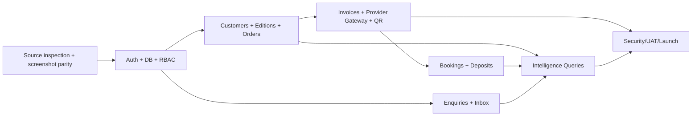

# 11 — Phased Build Plan, Dependencies and Delivery Gates

**Instruction to Claude:** build features, not slides/specs. At every milestone deliver a running app, code changes, test evidence and screenshots. Do not claim a payment/email integration works unless it is actually configured and tested.

## Phase 0 — Source audit and prototype conversion

**Inputs:** `references/lgndry-studio-crm-floating.html`, screenshot, PRD/TRD/flow/brand docs.

**Tasks:**

1. Record current HTML modules and seed-based interactions: overview, customers, orders, editions, enquiries, campaigns, insights, settings, search, drawer, modal, reset-demo.
2. Extract original style token values, sidebar structure, mobile behaviour, form conventions and artwork treatment. Identify localStorage-only logic that must **not** be migrated as financial authority.
3. Inspect target screenshot: `The Intelligence Center.` replaces old `A clearer picture.`; new Bookings, Invoices, Inbox; seven KPIs; booking calendar; collector signals; edition watch; insights and command notes.
4. Set up repo, pnpm workspace, Next.js/TypeScript, shared brand styles, lint/typecheck/tests, reference folder and design QA baseline.

**Gate:** working dev server and documented old-to-new migration map. Existing source files retained unchanged.

## Phase 1 — Design system + flagship UI parity

**Tasks:** floating sidebar with correct navigation order and all visual modules; header/search; Intelligence Center responsive static/data adapter views; accessible drawer/modal/table/chart; placeholder page shells for every nav destination, each with real route.

**Gate:** browser screenshots at 1672×941, 1440×900 and 390×844 compared with target, no broken navigation or horizontal overflow, keyboard operation. **Do this early**, before complex backend work makes visual drift costly.

## Phase 2 — Foundation and secure data

**Tasks:** Supabase projects by environment, migrations/RLS/grants, staff auth/invites/MFA, permission service, workspace config, audit events, demo fixtures, persistent customer records, safe global search, observability/CI, permission tests.

**Gate:** users with different roles have meaningfully different server-enforced access, data persists across reloads, demo/production separated, backup/restore procedure drafted.

## Phase 3 — Core commerce: customers / editions / orders

**Tasks:** authoritative artwork catalogue and variants, limited edition run inventory, temporary reservations and expiry, order submit and review, customer merge/timeline, production/dispatch statuses, storefront public APIs, idempotency and oversell tests.

**Gate:** one customer can create an order linked to real stock and customer; duplicate submit and simultaneous last-copy tests pass; status labels honest.

## Phase 4 — Invoice-first payment and documents

**Tasks:** invoice lifecycle, serials and immutable snapshots, PDF, machine-generated QR + Pay Invoice URL, merchant-provider adapter, sandbox payment session, signed webhook verification, settlement/refund ledger, transactional emails, outbox and retries, finance authorization, overdue reminders and exceptions.

**Gate:** valid sandbox payment changes invoice/order status exactly once; fails safely when no provider; PDF scannable; full audit; no bank or card data in frontend; financial acceptance tests pass.

## Phase 5 — Photography bookings

**Tasks:** service configuration, public request form endpoint, booking list/filter and calendar, quote and deposit/final-balance invoices, shoot brief/assignments, conflict prevention, photography delivery status and linked customer history.

**Gate:** request-to-deposit-to-confirmation-to-shoot-to-balance path works; double-booking test passes; request never masquerades as confirmed.

## Phase 6 — Communications and intelligence

**Tasks:** enquiries and Inbox threads, outbound transactional status, optional provider-backed inbound sync, drafts and assignment; campaigns draft/approval + consent-aware audience; authoritative KPI queries, collector signals, edition/fulfilment actions, date filters, drilldowns and export permissions.

**Gate:** dashboard values reconcile to ledger, actions link correctly, unsubscribed recipients never receive marketing, Inbox accurately marks connected/unconnected.

## Phase 7 — Hardening and go-live

**Tasks:** accessibility and responsive review, perf/load checks, RLS audit, full test matrix, penetration-oriented negative tests, legal invoice/policy review, secrets, backups, error monitoring, UAT, release checklist, production signoff and rollback procedure.

**Gate:** Owner, Finance, Studio Manager and Technical lead sign off critical journeys; no known critical/high security/financial/stock defects.

## Priority sequence across phases

The **full Intelligence Center visual layout** is Phase 1, but **real KPI data** is Phase 6. Demo adapters can support visual QA without misrepresenting production readiness.

## Milestone evidence required from Claude

At the end of each phase, Claude must provide:

- Actual files created/changed, including path list.
- Routes and workflows delivered, explicitly separated from mock-only or not-yet-integrated features.
- Commands run and test pass/fail output, not a blanket “all tests pass” without execution.
- Browser screenshot paths for desktop and mobile; describe any intentional differences from the target.
- Migrations and environment configuration needed to reproduce the milestone.
- Open blockers and deferred decisions with safe fallback and exact next action.

## Scope management rules

- Protect the core flow: **art order -> secure invoice -> verified payment -> unique edition -> fulfilment**; **booking request -> quote -> deposit -> confirmed shoot**. Everything else supports those two flows.
- Do not build an entire photography SaaS, a marketplace, a separate accounting package or sophisticated predictive AI in v1.
- Do not start the new storefront as a second fully developed app until Studio Desk exposes stable public order/booking APIs. The provided editorial storefront HTML is an art-direction reference, not a mandate to rebuild the website in this handoff.
- New features require a business outcome, owner, permission impact, domain entity and acceptance test. Log interesting ideas for P1 rather than quietly expanding v1.
